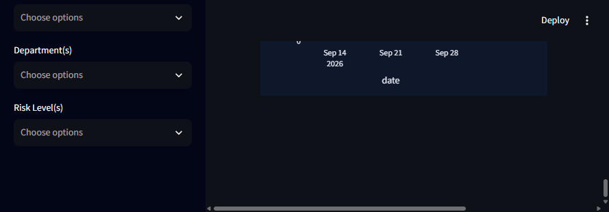
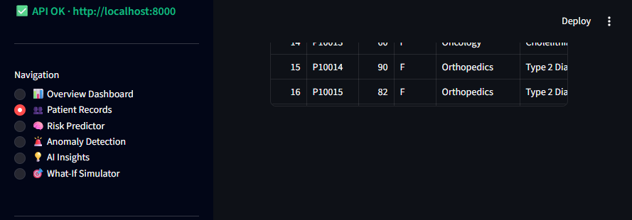
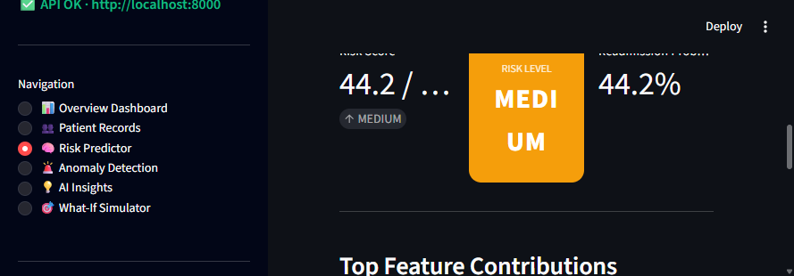
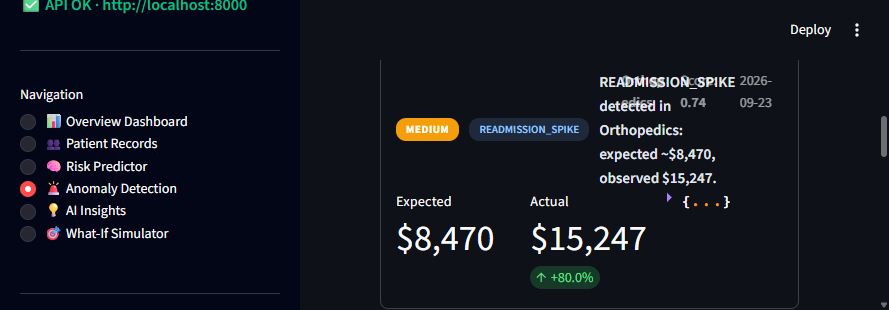
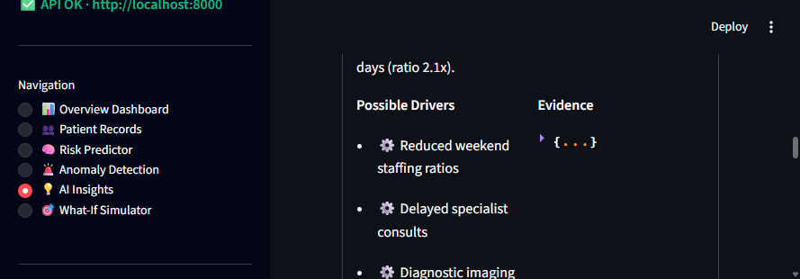
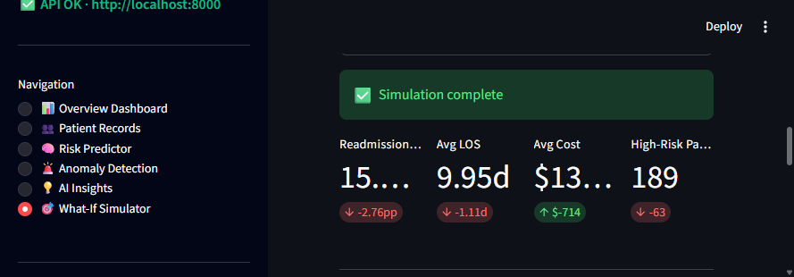

# 🏥 Healthcare Analytics Platform

> AI-Powered Healthcare Decision Intelligence Dashboard

A modern, full-stack healthcare analytics platform combining a **FastAPI** backend with a **Streamlit** interactive dashboard. Features include patient risk stratification, readmission prediction, anomaly detection, AI-generated clinical insights, and what-if scenario simulation — all on top of synthetic patient data ready to plug into real EHR pipelines.

---

## ✨ Key Features

| Module | Description |
|---|---|
| 📊 **Overview Dashboard** | 8 KPI cards + 8 interactive Plotly charts — admissions, readmission trend, LOS, cost, risk, department, diagnoses, anomalies |
| 👥 **Patient Records** | Searchable, filterable admissions table with risk-level color coding, pagination, and CSV export |
| 🧠 **Risk Predictor** | Individual 30-day readmission risk scoring using XGBoost-style model with feature-contribution breakdown |
| 🚨 **Anomaly Detection** | Statistical + Isolation Forest anomalies for cost, readmission, LOS, volume, and mortality shifts |
| 💡 **AI Insights** | Automated trend analysis with severity ranking, evidence, possible drivers, and recommended investigations |
| 🎯 **What-If Simulator** | Interventional KPI modeling — tune readmission rate, LOS, cost, and high-risk count to see population-level impact |
| 🧬 **Model Registry** | Active model info, versions, metrics (ROC-AUC, F1, MAE), and feature importance |
| 🔍 **RAG Knowledge Base** *(backend-ready)* | LangChain + FAISS/Chroma RAG for clinical policy Q&A |
| 💬 **Natural Language Analytics** *(backend-ready)* | NL → SQL auto-generation with chart suggestions |

---

## 📸 Screenshots

### 1. Overview Dashboard — KPIs, Trends & Charts



### 2. Patient Records — Search, Filter & Risk Stratification



### 3. Risk Predictor — Individual Readmission Risk + Feature Contributions



### 4. Anomaly Detection — Cost / LOS / Readmission Shifts



### 5. AI Insights — Auto-Generated Findings & Investigation Plans



### 6. What-If Simulator — Interventional Impact Modeling



---

## 🏗️ Architecture

```
┌────────────────────────────────────────────────────┐
│              Streamlit Dashboard (UI)               │
│   dashboard.py · 6 pages · Plotly · Styled dark    │
└──────────────────────────┬─────────────────────────┘
                           │ HTTP (httpx)
                           ▼
┌────────────────────────────────────────────────────┐
│              FastAPI Backend (API)                  │
│   main.py · 14+ REST endpoints · Pydantic · CORS   │
└───────┬───────────────┬──────────────┬─────────────┘
        │               │              │
        ▼               ▼              ▼
  ┌──────────┐   ┌─────────────┐  ┌──────────────┐
  │ backend/ │   │  backend/   │  │   backend/   │
  │  models  │   │    ml/      │  │  analytics/  │
  │schemas.py│   │ risk_pred   │  │ ai_insights  │
  │ SQLAlch  │   │ data_pipe   │  │ anomaly_det  │
  └──────────┘   └─────────────┘  │ decision_int │
                                  │ nl_analytics  │
                                  └──────────────┘
```

---

## 🛠️ Tech Stack

| Layer | Technology |
|---|---|
| **Frontend Dashboard** | Streamlit 1.64, Plotly 7, Altair 6 |
| **Backend API** | FastAPI 0.141, Uvicorn 0.53, Pydantic v2 |
| **Database** | SQLAlchemy 2.0 (PostgreSQL-ready via `DATABASE_URL`) |
| **ML / Stats** | pandas 3, numpy 2, scikit-learn, XGBoost, SHAP, MLflow |
| **RAG / LLM** | LangChain, FAISS / Chroma, OpenAI (gpt-4o-mini, text-embedding-3-small) |
| **Config** | pydantic-settings, python-dotenv |
| **Auth (ready)** | PyJWT, passlib[bcrypt] |

---

## 🚀 Quickstart

### Prerequisites

- Python 3.11+ (tested on 3.13)
- pip / venv
- *(Optional)* PostgreSQL 14+ — the app runs without it using in-memory synthetic data

### 1. Clone & Install

```bash
git clone https://github.com/itsaisha17/Healthcare-Platform.git
cd Healthcare-Platform
python -m venv .venv
# Windows:
.venv\Scripts\activate
# macOS/Linux:
source .venv/bin/activate
pip install -r requirements.txt
```

### 2. Configure

```bash
copy .env.example .env
# edit .env if you have PostgreSQL, OpenAI key, etc.
```

Defaults work out of the box with mock patient data (no DB required).

### 3. Start the FastAPI Backend

```bash
python main.py
# → http://localhost:8000
# Swagger docs: http://localhost:8000/docs
# Redoc:        http://localhost:8000/redoc
```

Verify with:
```bash
curl http://localhost:8000/health
# {"status":"ok","patients_loaded":500}
```

### 4. Launch the Streamlit Dashboard

```bash
streamlit run dashboard.py --server.port 8501
# → http://localhost:8501
```

That's it — open **http://localhost:8501** in your browser.

---

## 🔌 API Quick Reference

| Method | Path | Description |
|---|---|---|
| `GET` | `/health` | Health check with patient count |
| `GET` | `/api/kpis` | Key population KPIs |
| `GET` | `/api/dashboard/summary` | Full dashboard payload (KPIs + 8 chart series) |
| `GET` | `/api/data-summary` | Available filters, hospitals, depts, column stats |
| `GET` | `/api/patients` | Paginated patient records + search/filters |
| `GET` | `/api/patients/{id}` | Single patient record |
| `GET` | `/api/models` | Active ML model registry |
| `POST`| `/api/predict` | Readmission risk prediction (requires `patient_data` dict) |
| `GET` | `/api/anomalies` | Anomalies by severity filter |
| `GET` | `/api/insights` | AI-generated insights + drivers |
| `POST`| `/api/what-if` | What-if KPI simulation scenario |

### Example: Predict risk for a patient

```bash
curl -X POST http://localhost:8000/api/predict \
  -H "Content-Type: application/json" \
  -d '{"patient_data":{"age":72,"num_diagnoses":6,"length_of_stay":9,"previous_readmissions":2}}'
```

Response:
```json
{
  "risk_score": 78.4, "risk_level": "HIGH",
  "probability": 0.784,
  "top_features": [ ... ],
  "model_name": "readmission_risk_v1",
  "disclaimer": "Demo only; not clinical advice."
}
```

---

## 📂 Project Structure

```
healtcare/
├── main.py                      # FastAPI entry point + routes + mock data generator
├── dashboard.py                 # Streamlit 6-page dashboard UI
├── requirements.txt
├── .env.example
├── .gitignore
├── screenshots/                 # README screenshots (6)
├── backend/
│   ├── config.py                # Pydantic settings (DATABASE_URL, ports, etc.)
│   ├── database/
│   │   └── database.py          # SQLAlchemy engine + SessionLocal + init_db()
│   ├── models/
│   │   └── models.py            # 9 SQLAlchemy models (PatientRecord, AIInsight, ...)
│   ├── schemas/
│   │   └── schemas.py           # 25+ Pydantic request/response schemas
│   ├── analytics/
│   │   ├── ai_insights.py       # Insight generator (8 types, drivers, evidence)
│   │   ├── anomaly_detection.py # Multi-method anomaly detector
│   │   ├── decision_intelligence.py  # Decision actions + root cause
│   │   └── natural_language_analytics.py  # NL → SQL + chart suggestions
│   ├── ml/
│   │   ├── data_pipeline.py     # Cleaning, feature engineering, train/test splits
│   │   └── risk_prediction.py   # XGBoost/LR/RF training + SHAP explanations
│   ├── rag/
│   │   └── knowledge_rag.py     # LangChain document Q&A with FAISS/Chroma
│   └── services/                # (extend here for business logic)
└── data/                        # Ignored by default — vectorstore, models, uploads, mlruns
```

---

## 🧪 Synthetic Dataset

Ships with 500 synthetic admissions generated on startup:

- Demographics: age 18–92, gender, ethnicity, insurance
- Clinical: 10 diagnoses (ICD-style), 6 procedures, num meds/labs, LOS 1–21d
- Financial: treatment cost $3k–$28k (correlated to LOS, labs, dept)
- Outcomes: 18% baseline 30-day readmission rate, 4-tier risk (LOW→CRITICAL)
- Timeframe: rolling 12 months

To connect a real dataset: implement `POST /api/upload` with the existing `DatasetUploadResponse` schema, then swap the mock generator for real DB reads.

---

## ⚠️ Disclaimer

> This platform is a **decision-support prototype** for demonstration and educational purposes only. All patient data is synthetic. The predictions, insights, and simulations are NOT a substitute for professional medical advice, diagnosis, or treatment. Always seek the advice of your physician or other qualified health provider with any questions regarding a medical condition.

---

## 📄 License

MIT — feel free to fork, adapt, and extend.

Built with ❤️ using FastAPI, Streamlit, and Plotly.
